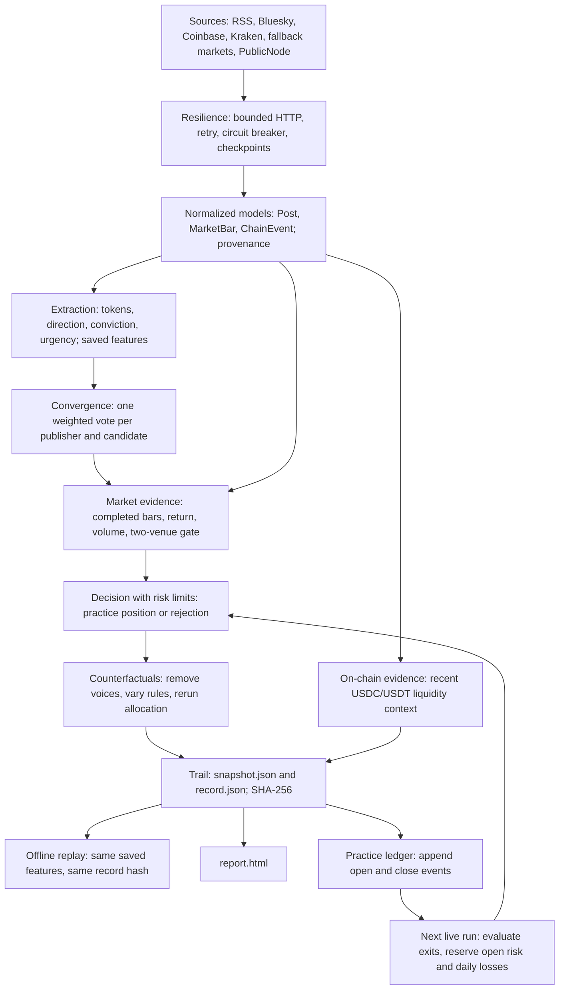

# Architecture

The runnable application is `cli.run → runtime.make_record`. It reuses the core's extraction, convergence, evidence and decision functions, but has its own privacy-preserving snapshot format and two-venue gate. `core.pipeline.evaluate` and `core.trail.replay` are a separate, full-text engine interface used by core tests; their record types must not be confused with CLI JSON files.



The on-chain branch supplies report context, not a decision vote. Collection is sequential; the diagram expresses data dependencies. Text extraction happens inside the source parser, before safe post metadata is checkpointed. Market fetches follow extraction because token mentions select the requested markets. Counterfactuals do not append ledger events.

## 1. Sources and observation context

**Implementation:** `cli.load_config`, `cli.run`; `sources/{rss,bluesky,coinbase,kraken,binance,coingecko,publicnode}.fetch`.

**Inputs:** voices/rules/risk JSON, requested hours, optional ledger path, output directory and chaos source. **Outputs:** parsed batches, fetch provenance, a frozen UTC `as_of`, and `run_context.json` containing `as_of` and `config_hash`.

The CLI accepts 1–20 unique publisher IDs and a 1–240-hour window. RSS and Bluesky channels of one publisher share one entry. RSS titles and summaries are processed transiently; original Bluesky author posts use `posts_no_replies` and exclude reposts, with at most five pages of 100 entries. Posts are filtered inclusively between `as_of - hours` and `as_of` and deduplicated by source/URI.

Markets are requested for recognized mentions and existing positions intersected with `sources.market.SYMBOLS`, plus BTC and ETH. Coinbase and Kraken are tried first. If fewer than two return nonempty completed bars, Binance and then CoinGecko are attempted until two successes exist. Successful collection is not equivalent to passing evidence checks. Coinbase/Kraken/Binance request hourly bars; CoinGecko uses its returned OHLC intervals and has no volume. Candle collection starts three hours before the narrative window, rounded down to the hour, to supply an anchor.

**Failure behavior:** invalid configuration fails with exit 1. Each source exception is caught and recorded so other sources can continue. An empty voice feed is degraded; a failed feed is down. An HTTP 404 market product is treated as unlisted and triggers fallback without that alone marking health down. No usable posts, bars or chain events produces `failure.json` and exit 1. With some inputs, missing evidence yields explicit rejections rather than fabricated observations.

## 2. Resilience and checkpointing

**Implementation:** `sources.common.Client.fetch`; `core.resilience.retry`, `CircuitBreaker.call`, `CheckpointStore.load/save`.

**Inputs:** source ID, URL, optional RPC payload and parser. **Outputs:** parsed JSON-safe values and provenance; hashed checkpoint entries keyed by source/endpoint/payload.

Live requests use an 8-second socket timeout, a 2,000,000-byte response cap and 0.2-second pacing. The client makes at most two attempts through `retry`, with a 0.5-second base delay, 2-second backoff cap and seeded jitter. Transport failures, HTTP 408/429 and 5xx are retryable; other 4xx and unclassified exceptions propagate. Retry-After on 429/503 is a minimum delay. A requested delay above 15 seconds defers that source for its interval instead of blocking the entire run; this does not schedule background work.

The per-source breaker opens after two consecutive failed calls, permits a half-open probe after 60 seconds, and resets on success. It is in memory. Successful parsed responses are checkpointed; full publisher prose is removed by parsers first. Checkpoints contain a checksum and commit with a temporary file, fsync and atomic replacement. A corrupt checkpoint raises an explicit error. Single-writer operation is assumed.

**Failure behavior:** failure diagnostics retain status/error without HTTP bodies. A kill value matches an exact source or a prefix such as `rss`; it raises before reading a checkpoint. `--kill publicnode` therefore forces a failure even if a response is cached. Reusing an output directory requires the same configuration hash, restores the original clock and reuses successful requests. A completed record returns its saved result. A snapshot saved before an interrupted final commit can regenerate the report, append idempotent ledger events and finish the record without refetching. This is local restart support, not a distributed exactly-once guarantee.

## 3. Normalized models and privacy boundary

**Implementation:** `core.models`; `sources.market.bars`, `sources.voices.prepare/batch`; `runtime.inputs`.

**Inputs:** parsed source rows. **Outputs:** immutable core models plus CLI metadata dictionaries. Dataclasses validate aware UTC times, finite numbers, positive prices, OHLC bounds and position consistency where applicable. Symbols are uppercased. Completed market bars have `end <= as_of`; venue series remain separate. Chain event identity includes transaction hash and event index.

`Post.text` initially holds transient normalized content. `prepare` hashes that content, extracts features and returns only metadata, scores/rules and an excerpt of at most 140 characters. For evaluation, `runtime.inputs` builds a temporary `Post` from the excerpt and attaches the saved full-content features. That temporary object's text hash describes the excerpt; the original full-content digest remains in the CLI post row and provenance. Replay never treats the excerpt as text to re-extract.

**Failure behavior:** malformed source rows can fail their adapter call; source-level handling records the error. The live CLI does not instantiate the full `Snapshot` dataclass or inherit all of its collection-level validations. It constructs a versioned dictionary and restores selected model types in `runtime.inputs`.

## 4. Extraction

**Implementation:** `core.extract.extract`, `_mentions`, `_scores`; called by `sources.voices.prepare`.

**Inputs:** normalized RSS title plus summary, or original Bluesky text. **Outputs:** per-clause `Signal` features and fired lexical rules.

Cashtags, known names and unambiguous symbols identify tokens; longer names win overlapping mentions. Common-word symbols require a name or cashtag. Clauses split at punctuation and contrast words. Directional words add or subtract 0.4; local negation reverses the contribution, with sentiment clipped to [-1, 1]. Its sign determines bullish/bearish/neutral. Conviction starts at 0.5, increases 0.15 for strong language and decreases 0.2 for hedges, with a negated-strength adjustment. Urgency adds 0.25 per matching time word. Conviction and urgency are clipped to [0, 1]. These are text scores, not probabilities. Urgency is retained but is not a decision gate.

**Failure behavior:** no token mention creates no candidate. Neutral or low-conviction mentions are kept for later explanation. Sarcasm, pronouns and multi-clause reference resolution are not implemented. Stored feature replay cannot verify whether extraction of the discarded original text was correct.

## 5. Convergence

**Implementation:** `core.converge.converge`; orchestration in `runtime.evaluate`.

**Inputs:** saved signals, selected voices, rules, frozen `as_of`. **Outputs:** a `Narrative` per token/direction, with members, voter weights and rule checks, including rejected candidates.

Only selected publishers and in-window posts count. Members meeting minimum conviction qualify their publisher to vote once per candidate. Weights are summed using decimal text to preserve inclusive boundary comparisons. Default trust is 0.8 per publisher, minimum conviction 0.5, quorum weight 1.5 and minimum distinct voices two. Direction must be nonneutral. The same publisher can support opposing candidates; if both directions converge, the decision layer rejects both. Ordering for allocation is descending weight, descending voice count, then token and direction.

**Failure behavior:** missing publishers do not lower thresholds. The CLI votes from successfully collected feature rows; a `down` health label is not a separate runtime filter over otherwise available bars or features. A failure cannot produce a hypothetical candidate whose missing post was never fetched. Unsupported token mentions still appear with missing market evidence.

## 6. Market and on-chain evidence

**Implementation:** `core.evidence.check_evidence`; `runtime.venue_evidence`; `sources.publicnode.fetch`.

**Inputs:** narratives and completed bars; separately, confirmed Ethereum log requests. **Outputs:** `Evidence`, per-venue evidence and cross-venue diagnostics; retained `ChainEvent` rows and a liquidity summary.

The CLI chooses up to two available venues in Coinbase, Kraken, Binance, CoinGecko order. It finds their latest common completed endpoint and truncates both series there. Window return is latest close / baseline close − 1; the baseline is the last close available at or before window start. Default maximum endpoint age and baseline gap are each two hours. The latest bar's volume z-score uses the preceding five volumes and population standard deviation; zero variance is undefined. Default directional return minimum is 1% and volume z minimum is 1.0.

Agreement requires two venues, a common endpoint, fresh endpoints/anchors, matching return signs and `abs(close1-close2)/min(close1,close2) <= 0.02`. Agreement permits the primary venue's evidence status to stand; it does not alone confirm a candidate. The secondary venue's volume need not confirm. Disagreement makes evidence contradictory; unavailable comparison makes it inconclusive. Binance's USDT quote basis is disclosed. CoinGecko's zero volume is an unavailable sentinel, so it cannot generate volume confirmation.

PublicNode samples 20 blocks ending at observed head minus 12 confirmations, in chunks of at most 10 by default. It verifies/caches token decimals using `eth_call`, fetches timestamps for retained events, ignores removed logs, checks requested ranges and deduplicates transaction/log-index pairs. It retains all mints/burns and ordinary transfers strictly above 1,000,000 token units. USDC/USDT totals are separate; large-transfer totals also include qualifying mints/burns. This sample is taken during collection and is not pinned to the narrative `as_of` or a full 48-hour interval.

**Failure behavior:** absent/stale bars, missing anchors, undefined volume or an unavailable second venue prevent default confirmation. An opposing observable return can contradict the narrative. PublicNode failure sets liquidity `available=false` and source health down, while decisions continue with market evidence. The core has optional exchange-flow logic, but the live CLI does not pass chain events to that logic and PublicNode does not label exchange flows. No chain vote, token attribution or reorg reconciliation is implemented.

## 7. Decision and portfolio risk

**Implementation:** `core.decide.decide`; `runtime.evaluate`; prior-state preparation by `ledger.evaluate`.

**Inputs:** narrative, evidence, risk limits, existing positions and today's gross realized practice losses. **Outputs:** `PracticePosition` or `Rejection`, each with a rule chain; rejection also lists every failed check evaluated for it.

Acceptance requires convergence, no convergent opposing direction, default market confirmation, a valid fresh entry reference, capacity below the open-position limit, no existing position in the token, daily loss below its cap, remaining daily risk and remaining gross account exposure. Accepted decisions reserve risk/exposure before the next candidate is evaluated.

```
daily_remaining = account_size * max_daily_loss_pct - realized_loss_today - open_stop_risk
risk_budget = min(account_size * max_loss_per_trade_pct, daily_remaining)
units = min(risk_budget / actual_stop_distance,
            account_size * max_position_pct / entry_price,
            remaining_account_exposure / entry_price)
```

Entry is the primary venue's completed close. Stop distance uses the configured fraction; target uses its reward multiple on the other side; time stop is observation time plus the hold limit. Floating-point size rounds down when necessary to respect caps. The defaults are a hypothetical $10,000 account, 10% position cap, 1% trade risk, 3% daily risk, three positions, 5% stop, 2R target and 24 hours.

**Failure behavior:** failed checks produce a rejection; invalid/unrepresentable exits or size also reject. Disabling confirmation is supported by configuration/interventions, but cannot bypass valid/fresh entry and risk checks. There are no real orders.

## 8. Counterfactuals

**Implementation:** `runtime.interventions`, rerunning `runtime.evaluate`.

**Inputs:** frozen snapshot and baseline outcomes. **Outputs:** one report per baseline candidate, with intervention values, acceptance before/after, flip flags and alternative failed-rule names.

Variants remove each publisher, move quorum/conviction by their configured steps (default 0.1), move minimum return by 0.005, move volume z by 0.5, and disable market confirmation. Values are bounded as implemented. Each variant reruns convergence, venue checks, conflicts and sequential portfolio allocation from the original prior positions. It does not carry new baseline positions into the alternative.

A decision-pivotal voice flips acceptance. A convergence-pivotal voice removes convergence even if both decisions remain rejections. A disappearing candidate is unaccepted with `no_candidate_after_intervention`. `sensitive_thresholds` in the CLI can also include `drop_market_evidence`.

**Failure behavior:** no flip is reported as none in tested steps, not global insensitivity. These are controlled causes of software decisions, not evidence that a publisher caused a price move. Alternative accepted positions never enter the live practice ledger.

## 9. Trail, hashing and replay

**Implementation:** `core.trail.canonical_json/content_hash`; `runtime.make_record`; `cli.write_json/replay`.

**Inputs:** the complete CLI snapshot, including settings, features, market bars, prior ledger state, health, provenance and paths. **Outputs:** `snapshot.json`, `record.json` and hashes. CLI schema version is integer `1`; runtime version is string `"1"`.

Canonical JSON sorts string mapping keys, preserves array order, encodes Unicode as UTF-8, serializes datetime objects in UTC with microseconds and `Z`, uses fixed-point `Decimal(str(float))` notation with a decimal point, and rejects NaN/infinity. Already stored timestamp strings remain strings. SHA-256 hashes the canonical UTF-8 bytes, not the pretty-printed file bytes.

- `snapshot_hash = content_hash(snapshot without expected_decision_hash)`.
- `decision_hash = content_hash(record without decision_hash)`; this covers the complete record, including outcomes, counterfactuals, health, provenance and the snapshot hash.
- The snapshot then stores `expected_decision_hash`, avoiding a circular dependency.
- `cli.replay` loads the snapshot, checks schema/runtime version via `make_record`, recomputes the full record and compares against the saved expected hash. It prints both hashes and `replay_match`; exit is 0 on match, 1 on mismatch/error. It performs no network requests and makes no ledger changes.

**Failure behavior and boundary:** changed snapshot inputs normally change the hash even if acceptance is unchanged. Paths, fetch times and list order are part of this contract; editing them is not a supported way to relocate the record internally. Copying an unchanged snapshot is fine. The expected hash is a local consistency reference, not a signature: someone able to edit both inputs and expected digest can create a new matching record. Replay checks deterministic evaluation of saved features; it cannot re-extract discarded text or prove authentic publisher bytes. There is no automatic code migration for future engine versions.

## 10. Report and practice ledger

**Implementation:** `report.render`; `ledger.read/evaluate/openings/append`; final commit in `cli.run`.

**Inputs:** snapshot, decision record and previous JSONL events. **Outputs:** escaped, self-contained HTML with inline CSS, plus append-only ledger events. Report headings are **Decision summary**, **Why**, **Cause and effect**, **Rejection ledger**, **Source health and provenance**, **Replay**. There are no charts, external scripts or dedicated ledger-history panel.

Later live runs evaluate exits using completed bars from one venue, preferring the entry venue. The first partial entry hour is excluded. For observable bars, time stop at/before bar start uses the open; otherwise stop is checked before target, then an elapsed time stop uses the close. Stop and target in the same bar resolve stop-first. Adverse gaps fill at the open. Missing intervals defer evaluation and preserve risk, with a ledger health note; no later bars leave the position open. Daily loss accounting sums gross negative closes dated today in UTC. No fees/slippage model or live fills are provided.

Ledger append deduplicates by `event_id`. Open IDs hash decision hash plus position. Close IDs hash the close event before its own ID is added. The final live commit writes snapshot, report, ledger events, then record. A resumed completed run does not evaluate fresh data.

**Failure behavior:** write/parse errors reach the CLI's exit-1 handler. Atomic checkpoint writes and idempotent ledger append aid restart, but the JSONL ledger has no transaction lock or corrupt-tail recovery; use a single writer. HTML is generated from saved values, including source errors and unavailable fields.

## Degraded mode

`runtime.make_record` sets `degraded` when any `source_health.state` is not `healthy`. Source state is merged across requests: all healthy stays healthy, all down stays down, mixed states become degraded. Empty in-window voice feeds are degraded. Successful fallback does not erase an actual outage; an unlisted-product 404 is the specific non-outage exception.

The report says **“State: degraded; thresholds unchanged”** in **Decision summary**, and lists source state/detail under **Source health and provenance**. Quorum and evidence rules are unchanged. CLI completion returns 2. With `chaos --kill publicnode`, the PublicNode detail names the deliberate failure, liquidity is unavailable, and the other sources still run. Chaos is a fresh observation, so it is not itself a controlled same-snapshot comparison of every input. The core-only `health_notes` function's available-voice denominator text is not emitted by the CLI report.

## Schemas generated from the dataclasses

The table below is generated with `dataclasses.fields` from `convergence_desk/core/models.py`, including fixed `kind` fields. It documents the core contracts, not an invented CLI dataclass. Reproduce from the repository root:

```bash
python - <<'PY'
from dataclasses import fields, is_dataclass
from convergence_desk.core import models
for name, cls in vars(models).items():
    if isinstance(cls, type) and is_dataclass(cls):
        print('| `' + name + '` | ' + ', '.join('`' + f.name + '`' for f in fields(cls)) + ' |')
PY
```

| Dataclass | Fields in declaration order |
|---|---|
| `Post` | `source`, `author_id`, `author_label`, `uri`, `created_at`, `text`, `content_sha256` |
| `Voice` | `id`, `label`, `source`, `trust_weight` |
| `MarketBar` | `symbol`, `start`, `open`, `high`, `low`, `close`, `volume`, `source`, `end` |
| `ChainEvent` | `chain`, `tx_hash`, `block`, `token`, `from_addr`, `to_addr`, `amount`, `label`, `occurred_at`, `source`, `event_index` |
| `RiskLimits` | `account_size`, `max_position_pct`, `max_loss_per_trade_pct`, `max_daily_loss_pct`, `max_open_positions`, `stop_pct`, `take_profit_r`, `max_hold_hours` |
| `Rules` | `window_hours`, `quorum_weight`, `min_distinct_voices`, `min_conviction`, `market_min_return`, `market_min_volume_z`, `volume_lookback`, `max_market_age_hours`, `quorum_step`, `conviction_step`, `require_market_evidence` |
| `RuleCheck` | `rule`, `passed`, `actual`, `expected`, `detail` |
| `Score` | `value`, `fired` |
| `Signal` | `post`, `token`, `direction`, `sentiment`, `conviction`, `urgency`, `token_rules` |
| `Narrative` | `token`, `direction`, `members`, `first_post_time`, `last_post_time`, `voice_weights`, `total_weight`, `distinct_voices`, `converged`, `checks` |
| `Evidence` | `status`, `return_fraction`, `volume_z`, `entry_price`, `entry_time`, `market_source`, `checks`, `chain_totals`, `chain_bias`, `notes` |
| `PracticePosition` | `token`, `direction`, `entry_price`, `entry_time`, `stop`, `take_profit`, `time_stop`, `units`, `notional`, `risk_amount`, `rule_chain`, `opened_at`, `kind` |
| `Rejection` | `token`, `direction`, `failed_rules`, `rule_chain`, `kind` |
| `SourceHealth` | `source`, `state`, `detail` |
| `Snapshot` | `as_of`, `posts`, `voices`, `market_bars`, `risk_limits`, `rules`, `chain_events`, `open_positions`, `realized_loss_today`, `source_health`, `degraded_notes` |
| `Outcome` | `narrative`, `evidence`, `decision` |
| `CounterfactualTrial` | `change`, `value`, `baseline_accepted`, `alternative_accepted`, `flipped`, `failed_rules` |
| `CounterfactualReport` | `token`, `direction`, `pivotal_voices`, `sensitive_thresholds`, `trials` |
| `InputReference` | `kind`, `source`, `identity`, `content_sha256` |
| `DecisionRecord` | `schema_version`, `as_of`, `snapshot_hash`, `inputs`, `outcomes`, `counterfactuals`, `source_health`, `degraded_notes`, `decision_hash` |

## CLI JSON envelopes and ledger events

The following field lists were generated from the live snapshot and record at `2026-10-30T01:17:03.356069Z`, then checked against `cli.run` and `runtime.make_record`. These envelopes are dictionaries, not the `Snapshot`/`DecisionRecord` dataclasses above. JSON arrays represent dataclass tuples; times are UTC strings; optional values may be null.

| Object | Observed fields |
|---|---|
| CLI snapshot.json | `as_of`, `chain_events`, `coverage`, `expected_decision_hash`, `ledger_close_events`, `ledger_path`, `liquidity`, `market_bars`, `open_positions`, `post_counts`, `posts`, `provenance`, `realized_loss_today`, `recorded_test_fixture`, `risk_limits`, `rules`, `run_path`, `runtime_version`, `schema_version`, `source_health`, `source_rules`, `voices` |
| CLI record.json | `as_of`, `counterfactuals`, `counts`, `coverage`, `decision_hash`, `degraded`, `liquidity`, `outcomes`, `practice_only`, `provenance`, `recorded_test_fixture`, `runtime_version`, `schema_version`, `snapshot_hash`, `source_health` |
| CLI post row | `author`, `author_id`, `author_label`, `content_sha256`, `created_at`, `excerpt`, `features`, `provenance`, `source`, `title_sha256`, `uri` |
| CLI voice row | `label`, `rss`, `trust_weight`, `voice_id` |
| Source rules | `chain_blocks`, `chain_chunk_size`, `chain_confirmations`, `cross_venue_max_spread`, `large_transfer_threshold` |
| Counts | `converged_narratives`, `posts`, `posts_by_source`, `practice_positions`, `rejections` |
| Coverage | `bluesky_max_pages`, `feed_history`, `ledger_notes`, `market_symbols`, `unsupported_tokens` |
| CLI outcome | `cross_venue`, `decision`, `evidence`, `narrative` |
| CLI narrative member | `conviction`, `direction`, `sentiment`, `token`, `token_rules`, `urgency`, `uri`, `voice_id` |
| Cross-venue detail | `common_completed_endpoint`, `max_spread`, `relative_close_spread`, `same_return_direction`, `status`, `venue_evidence`, `venues` |
| CLI counterfactual | `convergence_pivotal_voices`, `direction`, `pivotal_voices`, `sensitive_thresholds`, `token`, `trials` |
| CLI trial | `alternative_accepted`, `baseline_accepted`, `change`, `failed_rules`, `flipped`, `value` |

The CLI post `features` array contains the `Signal` fields except `post`; its score objects retain `value` and `fired`. CLI narrative members use compact URI/voice/feature references instead of embedding a full `Post`. Other narrative, evidence and decision fields follow the dataclasses. The CLI adds `cross_venue` to each outcome and `convergence_pivotal_voices` to each counterfactual report. CLI voices use `voice_id` and channel configuration rather than the core `Voice.id/source` shape.

Provenance objects have `source`, `endpoint`, `fetch_time`, `http_status`; successes have `response_sha256`, RPC requests add `rpc_request`, item references add `identity` and `content_sha256`, and failures have `error`. CoinGecko item references add `volume_available=false`. Liquidity success fields are `available`, `first_block`, `last_block`, `chunk_size`, `confirmations`, `large_transfer_threshold`, `decimals`, `scope`, `tokens`. Each token summary has `mint_total`, `burn_total`, `large_transfer_count`, `large_transfer_total`; decimals include their own provenance. Failure liquidity has `scope`, `available=false`, `error`.

Ledger events are constructed dictionaries in `ledger.py`, not dataclasses:

| Event | Fields |
|---|---|
| Open (`ledger.openings`) | `event`, `event_id`, `position_id`, `practice_only`, `decision_hash`, `position`, `market_source` |
| Close (`ledger.evaluate`) | `event`, `practice_only`, `position_id`, `reason`, `exit_price`, `evaluated_at`, `closed_at`, `pnl`, `market_source`, `assumption`, `event_id` |

For the separate core-only interface, `snapshot_to_json` wraps the dataclass as `schema_version`, `engine_version`, `snapshot`. Core `DecisionRecord.inputs` contains `InputReference` entries; the CLI instead retains its source provenance and hashes the whole CLI snapshot. These two snapshot envelopes are not interchangeable with the other interface's replay function.
